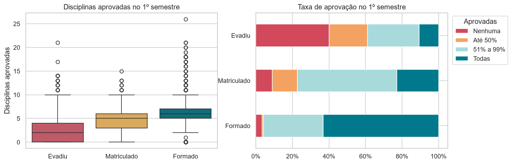
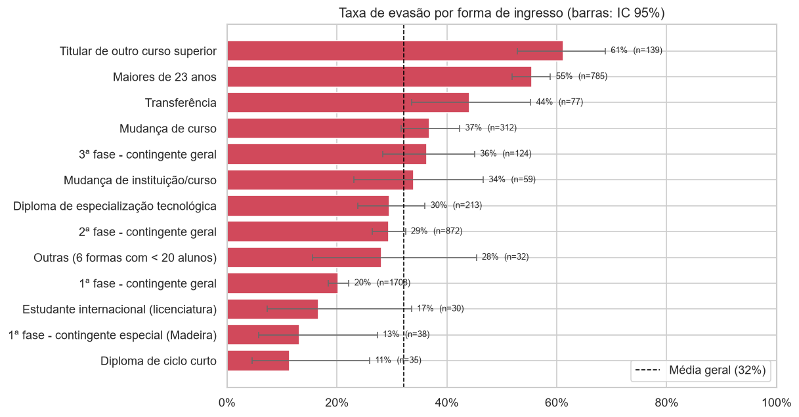
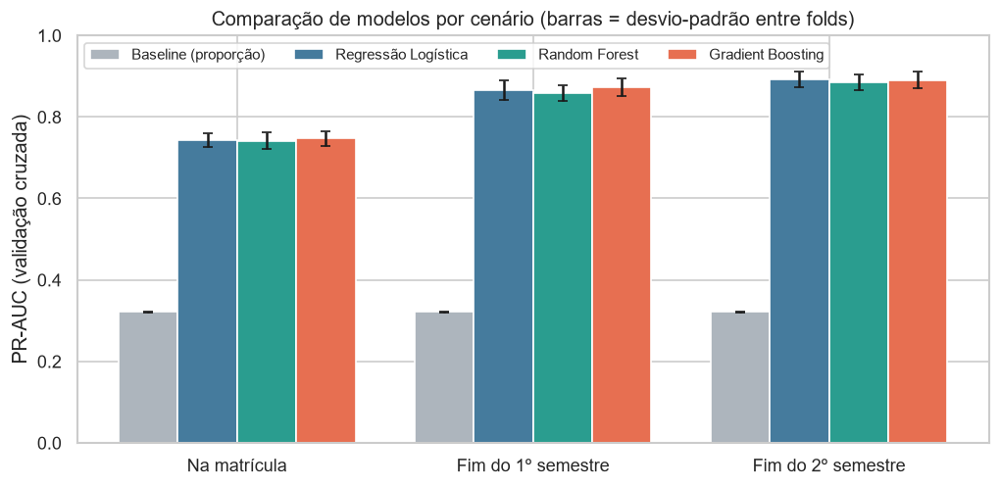
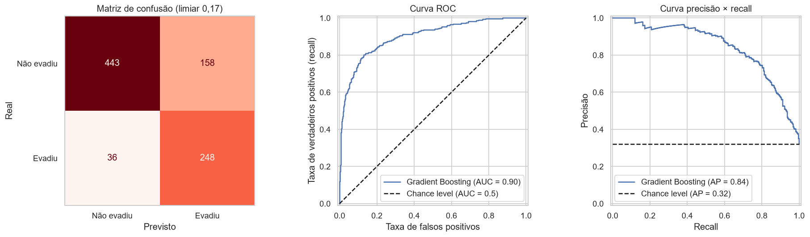
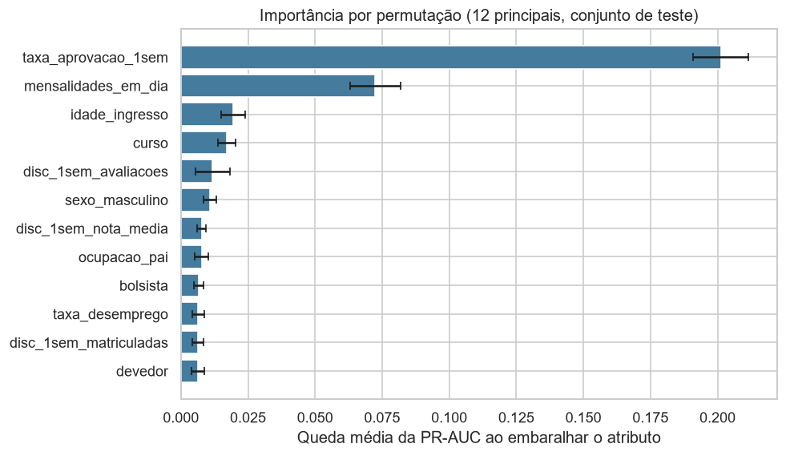

# 🎓 Radar de Evasão

### Previsão do risco de evasão no ensino superior com Machine Learning

**Projeto N3 · Turma 8NA · Equipe 10**

| Integrante | Contribuição |
|---|---|
| Artur Zanella | Pesquisou os dados de evasão no Brasil no Censo da Educação Superior (INEP) e os incluiu na introdução, com as fontes (seção 1 e referências) |
| Guilherme Freiberger | Montou o projeto: preparação dos dados, notebooks de exploração e modelagem, comparação e treino dos modelos, previsão para novos alunos, interface em Streamlit e README |
| Lucas Mueller | Rodou o notebook 01 do zero (todas as saídas batem com as do repositório). Acrescentou a análise de evasão por forma de ingresso (seção 7 do notebook 01) |
| Vinicius Fernandes | Rodou o notebook 02 do zero e conferiu os números com o README e a apresentação (todos batem). Analisou os 36 falsos negativos (seção 7.1 do notebook 02) |

---

## Resumo

Treinamos um modelo que estima a **probabilidade de um aluno de graduação evadir** a partir dos dados da matrícula e do desempenho no **1º semestre**. No conjunto de teste (885 alunos nunca vistos), o modelo **identificou 87% dos alunos que evadiram**, com ROC-AUC de 0,90. Uma interface em Streamlit permite informar um aluno novo e ver o risco e os fatores que mais pesam para ele.

---

## 1. Introdução

A evasão no ensino superior é um problema caro para todos os lados: o aluno perde tempo e dinheiro, a instituição perde receita e fica com vagas ociosas, e a sociedade perde profissionais formados.

No Brasil, ela atinge a maioria dos ingressantes. O Censo da Educação Superior do INEP acompanha, ano a ano, a trajetória de cada turma de ingressantes. Na edição de 2024, dos alunos que entraram na graduação em 2015, **60% tinham desistido do curso até 2024** (o décimo ano de acompanhamento), 39% se formaram e 1% continuava matriculado (INEP, 2025). O número quase não muda de uma turma para outra: ficou entre 58% e 60% para os ingressantes de 2010 a 2015.

| Ingressantes de 2015, situação em 2024 | Desistência acumulada |
|---|---|
| **Brasil** | **60%** |
| Rede pública / rede privada | 53% / 62% |
| Presencial / EaD | 59% / 65% |
| Rede privada: com FIES / sem FIES | 47% / 65% |
| Rede privada: com Prouni / sem Prouni | 41% / 64% |

*Fonte: INEP (2025), gráficos 63 a 69. Conta como desistência o aluno desvinculado do curso em que ingressou ou transferido para outro curso da mesma instituição (INEP, 2017). É uma medida de saída do curso, não necessariamente do ensino superior.*

Dois pontos desses dados sustentam a proposta deste projeto:

- **A desistência acontece cedo.** 13% dos ingressantes de 2015 saíram ainda no ano de ingresso e 29% até o fim do ano seguinte, quase metade de toda a desistência acumulada em dez anos. Um alerta só ajuda se chegar antes disso, e o modelo deste projeto prevê ao fim do 1º semestre (seção 4.2).
- **Apoio financeiro anda junto com permanência.** Na rede privada, quem tinha FIES ou Prouni desistiu bem menos do que quem não tinha. O mesmo padrão aparece nos dados deste projeto, em que bolsistas evadem bem menos (seção 4.1).

Pela teoria clássica de Tinto (1975), a evasão é um processo gradual, ligado à integração acadêmica e social do estudante. Isso significa que **há sinais antes da saída**, e que uma intervenção precoce (monitoria, apoio financeiro, acolhimento) pode mudar o desfecho.

O problema é que coordenações de curso costumam ter centenas de alunos e pouco tempo. **Uma ferramenta que priorize quem mais precisa de atenção** ajuda a usar melhor esse tempo.

## 2. Objetivo e quem usaria

**Objetivo:** estimar, ao fim do 1º semestre, a probabilidade de cada aluno evadir do curso e indicar os fatores que mais contribuem para esse risco.

**Quem usaria:**

- **Coordenações de curso**, para montar a lista de alunos a acompanhar no 2º semestre;
- **Núcleos de apoio ao estudante** (psicopedagógico, monitoria), para priorizar atendimentos;
- **Setor financeiro e de bolsas**, para oferecer negociação ou bolsa a quem tem risco ligado a mensalidades.

O resultado é um **apoio à decisão**, não uma decisão automática. Serve para oferecer ajuda e nunca para restringir ou punir alunos.

## 3. Dados

| | |
|---|---|
| **Dataset** | *Predict Students' Dropout and Academic Success* |
| **Fonte** | UCI Machine Learning Repository: <https://archive.ics.uci.edu/dataset/697/predict+students+dropout+and+academic+success> |
| **DOI** | [10.24432/C5MC89](https://doi.org/10.24432/C5MC89) |
| **Licença** | CC BY 4.0 (uso e redistribuição permitidos com atribuição) |
| **Origem** | Instituto Politécnico de Portalegre (Portugal), 17 cursos de graduação, ingressantes de 2008/09 a 2018/19 |
| **Tamanho** | 4.424 alunos × 36 atributos + alvo, sem valores ausentes nem duplicados |
| **Alvo** | Situação ao fim do tempo normal do curso: Evadiu (32%), Matriculado (18%), Formado (50%) |

Os atributos cobrem perfil (idade, sexo, estado civil, nacionalidade), família (escolaridade e ocupação dos pais), ingresso (curso, turno, forma de ingresso, nota de admissão), situação financeira (mensalidades em dia, devedor, bolsista), desempenho no 1º e 2º semestres (disciplinas matriculadas, avaliadas, aprovadas, nota média) e indicadores macroeconômicos do ano de ingresso.

O arquivo original está em [`data/dados_evasao_uci.csv`](data/dados_evasao_uci.csv), sem modificações.

## 4. Metodologia

### 4.1 Exploração e preparação ([`notebooks/01_exploracao.ipynb`](notebooks/01_exploracao.ipynb))

| Tratamento | Justificativa |
|---|---|
| Colunas renomeadas para português e TAB removido do cabeçalho | Legibilidade e evitar erro de leitura |
| Sem imputação nem remoção de linhas | Não há ausentes nem duplicados |
| *Outliers* mantidos | Valores plausíveis: idades até 70 anos; nota 0 significa "sem avaliação" |
| **Alvo binário: evadiu × não evadiu** | Corresponde à decisão real ("acompanhar ou não"). A versão com 3 classes foi testada e é pior (seção 5.4) |
| One-hot nos 9 códigos nominais, agrupando categorias com < 20 alunos | Os códigos não têm ordem, e categorias raras causam *overfitting* |
| Padronização só na Regressão Logística | Ela é sensível à escala, árvores não são |
| **Novo atributo:** taxa de aprovação = aprovadas ÷ matriculadas | Normaliza o desempenho pela carga de disciplinas |
| Todo o pré-processamento dentro de um `Pipeline` do scikit-learn | Evita vazamento de dados na validação cruzada |

Principais achados da exploração:

- **40% de quem evadiu não foi aprovado em nenhuma disciplina no 1º semestre**, contra 3,5% dos formados.
- Mensalidades atrasadas: 87% de evasão, contra 25% de quem estava em dia.
- Bolsistas evadem bem menos (12% contra 39%).
- A evasão varia de 15% (Enfermagem) a 54% (Engenharia Informática).
- **Forma de ingresso:** "maiores de 23 anos" (55%) e "titulares de outro curso superior" (61%) evadem bem acima da média. Os maiores de 23 anos são 18% dos alunos, mas respondem por 31% das evasões. No concurso nacional, a evasão sobe a cada fase (20% na 1ª, 29% na 2ª, 36% na 3ª). As diferenças continuam ao comparar alunos da mesma idade e com o mesmo desempenho no 1º semestre (seção 7 do notebook 01).

<p align="center"></p>

<p align="center"></p>

### 4.2 Em que momento prever? Três cenários

Usar informação que ainda não existe no momento da decisão deixaria a avaliação otimista e o modelo inútil na prática. Por isso cada cenário só usa o que já se sabe naquele momento:

| Cenário | Atributos usados | Tempo para agir |
|---|---|---|
| Na matrícula | perfil, família, ingresso, financeiro, macroeconomia | o curso inteiro |
| **Fim do 1º semestre** ✅ | + desempenho no 1º semestre | do 2º semestre em diante |
| Fim do 2º semestre | + desempenho no 2º semestre | do 2º ano em diante |

### 4.3 Modelos e avaliação ([`notebooks/02_modelagem_avaliacao.ipynb`](notebooks/02_modelagem_avaliacao.ipynb))

- **Modelos comparados:**
  - Baseline (prevê sempre a proporção de evasão);
  - Regressão Logística;
  - Random Forest;
  - Gradient Boosting (`HistGradientBoostingClassifier`).
- **Divisão:** 80% treino / 20% teste, estratificada. O teste só é usado uma vez, no final.
- **Validação cruzada estratificada (5 folds)** no treino, para comparar modelos e ajustar hiperparâmetros por *grid search*.
- **Métrica principal: PR-AUC.** Ela resume precisão e recall para a classe "evadiu" e é mais informativa que a ROC-AUC quando a classe positiva é minoria (Saito & Rehmsmeier, 2015). Também reportamos ROC-AUC, recall, precisão e F1.
- **Limiar de decisão:** escolhido maximizando o **F2** (recall com peso 2) nas previsões *fora da amostra* do treino. Deixar passar um aluno que vai evadir custa mais do que conversar com um que não evadiria.
- **Desbalanceamento** (32% × 68%): tratado pelo limiar, **sem** `class_weight`. Assim as probabilidades continuam calibradas e podem ser mostradas ao usuário.

## 5. Resultados

### 5.1 O momento da previsão importa mais que o algoritmo

PR-AUC média na validação cruzada (5 folds, conjunto de treino):

| Modelo | Na matrícula | Fim do 1º semestre | Fim do 2º semestre |
|---|---|---|---|
| Baseline | 0,321 | 0,321 | 0,321 |
| Regressão Logística | 0,744 | 0,866 | 0,891 |
| Random Forest | 0,741 | 0,858 | 0,885 |
| **Gradient Boosting** | **0,747** | **0,873** | **0,891** |

<p align="center"></p>

- A diferença entre algoritmos no mesmo cenário é de no máximo 0,015. Já a passagem da matrícula para o fim do 1º semestre ganha **+0,13**.
- Do 1º para o 2º semestre o ganho é pequeno (+0,02) e custa um semestre de intervenção. Por isso o **modelo final é o Gradient Boosting no cenário "fim do 1º semestre"**, com `learning_rate=0.1`, `max_iter=200` e `max_leaf_nodes=7` escolhidos pelo *grid search*.
- **Teste de sensibilidade:** sem os atributos financeiros, a PR-AUC cai de 0,747 para 0,620 na matrícula, mas só de 0,873 para 0,834 no fim do 1º semestre. O cenário escolhido depende menos desses dados, cuja data de medição é incerta.

### 5.2 Desempenho no conjunto de teste (885 alunos)

| Métrica | Valor |
|---|---|
| ROC-AUC | **0,90** |
| PR-AUC | **0,84** |
| Recall (evasões identificadas) | **87%** (248 de 284) |
| Precisão (sinalizados que evadiram) | **61%** (248 de 406) |
| F1 / F2 | 0,72 / 0,80 |
| Limiar | 0,17 |

<p align="center"></p>

Os resultados no teste ficam próximos aos da validação cruzada (PR-AUC 0,875), sem sinal de *overfitting*. As probabilidades são **bem calibradas** ([gráfico](reports/figuras/10_calibracao.png)): quando o modelo diz 80%, cerca de 80% dos alunos evadem de fato.

**Níveis de risco** usados na demonstração:

| Probabilidade | Risco | Ação sugerida |
|---|---|---|
| < 17% | 🟢 baixo | acompanhamento de rotina |
| 17% a 60% | 🟡 moderado | contato do tutor, convite para monitoria |
| ≥ 60% | 🔴 alto | atendimento individual prioritário |

### 5.3 O que o modelo aprendeu

<p align="center"></p>

A **taxa de aprovação no 1º semestre** é de longe o fator mais importante: embaralhá-la derruba a PR-AUC em 0,20. Depois vêm **mensalidades em dia** (0,07) e, bem atrás, idade, curso e número de avaliações. Indicadores macroeconômicos e escolaridade dos pais pouco contribuem.

### 5.4 Erros e limitações

- **Falsos negativos (36):** parecem alunos que vão bem (aprovação de 84%, mensalidades em dia). Provavelmente saíram por motivos que **não estão nos dados**: emprego, mudança, saúde, troca de curso.
  - Olhando caso a caso: todos tinham mensalidades em dia, 19 continuaram bem também no 2º semestre e 14 ficaram perto do limiar (entre 0,10 e 0,17). Rodando o modelo de novo no fim do 2º semestre, 11 dos 36 receberiam o alerta, então vale usar o modelo **em duas rodadas** (fim do 1º e do 2º semestre). Detalhes na seção 7.1 do notebook 02.
- **Falsos positivos (158):** têm desempenho fraco, e **94 deles ainda estavam matriculados**, ou seja, atrasados no curso. Para a coordenação, também são alunos que precisam de atenção.
- **Equidade:** o recall fica entre 80% e 94% em todos os grupos de sexo, turno e faixa etária.
- **3 classes:** prever *evadiu / matriculado / formado* dá 74% de acurácia, mas só 33% de recall em "matriculado" e 71% em "evadiu". Isso confirma a escolha pelo alvo binário.
- **Limitações:**
  - os dados vêm de **uma instituição portuguesa**, e seria preciso retreinar com dados locais para usar no Brasil;
  - não se sabe **quando** "mensalidades em dia" foi medido;
  - o modelo aprende **associações, não causas**;
  - o modelo usa atributos sensíveis (sexo, idade, estado civil), o que exige uso cuidadoso e monitoramento.

## 6. Demonstração

### Interface (Streamlit)

```powershell
streamlit run app.py
```

O usuário informa os dados do aluno, ou escolhe um dos três alunos fictícios de exemplo, e recebe:

- a **probabilidade de evasão** e o **nível de risco**;
- **"O que mais pesa para este aluno"**: simulações do tipo *"com as mensalidades em dia, o risco cairia de 97% para 81%"*. Cada uma muda um fator para o patamar típico de quem não evadiu e mede o novo risco.

<p align="center"></p>

### Script e função

```powershell
python -m src.prever                                  # roda os 3 alunos de exemplo
python -m src.prever exemplos/aluno_risco_alto.json   # roda um aluno específico
```

```text
=== Risco alto: Engenharia Informática, mensalidades atrasadas ===
Curso: Engenharia Informática | idade: 24
Probabilidade de evasão: 97% -> risco ALTO
Sugestão: incluir na lista de acompanhamento da coordenação.
O que mais pesa para este aluno (segundo o modelo):
  - Com aprovação em 6 de 6 disciplinas no 1º semestre (o típico de quem não evadiu), o risco cairia para 71% (-26 p.p.)
  - Com as mensalidades em dia, o risco cairia para 81% (-15 p.p.)
  - Com bolsa de estudos, o risco cairia para 94% (-2 p.p.)
```

Também dá para usar a função diretamente no Python:

```python
from src.prever import carregar_modelo, prever_evasao

modelo = carregar_modelo()
resultado = prever_evasao(modelo, {"curso": 9119, "idade_ingresso": 24, "mensalidades_em_dia": 0,
                                   "disc_1sem_matriculadas": 6, "disc_1sem_aprovadas": 1,
                                   "disc_1sem_avaliacoes": 8, "disc_1sem_nota_media": 10.5})
print(resultado["probabilidade_evasao"], resultado["risco"])
```

Campos não informados são preenchidos com o valor mais comum (ou a mediana) dos alunos de treino.

## 7. Como executar

Requer **Python 3.11 ou superior** (testado com 3.12).

```powershell
git clone https://github.com/guifreiberger/radar-evasao.git
cd radar-evasao
python -m venv .venv
.venv\Scripts\activate          # Windows  (Linux/macOS: source .venv/bin/activate)
pip install -r requirements.txt
```

| Comando | O que faz | Tempo |
|---|---|---|
| `streamlit run app.py` | Abre a demonstração no navegador | segundos |
| `python -m src.prever` | Prevê os alunos de exemplo no terminal | segundos |
| `python -m src.treinar` | Refaz todo o treino e salva `models/modelo_evasao.joblib` | ~1 min |
| `jupyter notebook notebooks/` | Abre os notebooks de exploração e modelagem | ~1 min por notebook |

O modelo treinado já está no repositório, então o app funciona sem treinar de novo. Todas as etapas usam semente fixa (`random_state=42`), e os números são reproduzíveis.

## 8. Estrutura do repositório

```text
├── app.py                          # interface Streamlit (demonstração)
├── data/dados_evasao_uci.csv       # dataset original (UCI, CC BY 4.0)
├── exemplos/                       # 3 alunos fictícios em JSON
├── models/modelo_evasao.joblib     # modelo final treinado
├── notebooks/
│   ├── 01_exploracao.ipynb         # exploração e justificativa dos tratamentos
│   └── 02_modelagem_avaliacao.ipynb# comparação, ajuste, limiar, teste, erros
├── reports/
│   ├── comparacao_modelos.csv      # validação cruzada de todos os modelos e cenários
│   ├── metricas_modelo_final.json  # métricas do modelo final
│   └── figuras/                    # gráficos usados aqui e na apresentação
├── src/
│   ├── dados.py                    # leitura, nomes, grupos de atributos, cenários
│   ├── modelo.py                   # pipelines, validação cruzada, limiar, métricas
│   ├── treinar.py                  # treina e salva o modelo final
│   └── prever.py                   # previsão + explicação para um aluno novo
└── requirements.txt
```

## 9. Considerações finais

1. **É possível prever a evasão cedo e com boa qualidade.** Ao fim do 1º semestre, o modelo identifica 87% dos alunos que vão evadir (ROC-AUC 0,90), com probabilidades calibradas que podem ser mostradas diretamente à coordenação.
2. **Quando prever importa mais do que qual algoritmo usar.** Os três modelos ficaram a no máximo 0,015 de PR-AUC entre si. O que muda o resultado é ter o desempenho do 1º semestre. A Regressão Logística, mais simples e explicável, ficou quase empatada e seria uma alternativa válida.
3. **Os sinais mais fortes são acionáveis.** Desempenho acadêmico inicial e situação financeira lideram. Isso aponta para ações como monitoria nas disciplinas do 1º semestre, negociação de mensalidades e bolsas.
4. **O modelo não vê tudo.** Parte das evasões acontece por motivos pessoais ausentes dos dados. Como trabalho futuro, seria valioso incluir frequência, uso do ambiente virtual e questionários, e **retreinar com dados de uma instituição brasileira** antes de qualquer uso real.

## 10. Referências

- BREIMAN, L. Random Forests. **Machine Learning**, v. 45, p. 5-32, 2001.
- FRIEDMAN, J. H. Greedy function approximation: a gradient boosting machine. **The Annals of Statistics**, v. 29, n. 5, p. 1189-1232, 2001.
- INEP. **Metodologia de cálculo dos indicadores de fluxo da educação superior**. Brasília: Instituto Nacional de Estudos e Pesquisas Educacionais Anísio Teixeira, 2017. Disponível em: <https://download.inep.gov.br/informacoes_estatisticas/indicadores_educacionais/2017/metodologia_indicadores_trajetoria_curso.pdf>. Acesso em: 25 nov. 2026.
- INEP. **Censo da Educação Superior 2024: divulgação dos resultados**. Brasília: Instituto Nacional de Estudos e Pesquisas Educacionais Anísio Teixeira, 17 set. 2025. Disponível em: <https://download.inep.gov.br/educacao_superior/censo_superior/documentos/2024/apresentacao_censo_da_educacao_superior_2024.pdf>. Acesso em: 25 nov. 2026.
- KE, G. et al. LightGBM: a highly efficient gradient boosting decision tree. In: **Advances in Neural Information Processing Systems 30 (NIPS 2017)**, 2017.
- PEDREGOSA, F. et al. Scikit-learn: Machine Learning in Python. **Journal of Machine Learning Research**, v. 12, p. 2825-2830, 2011.
- REALINHO, V.; MACHADO, J.; BAPTISTA, L.; MARTINS, M. V. Predicting Student Dropout and Academic Success. **Data**, v. 7, n. 11, p. 146, 2022. DOI: [10.3390/data7110146](https://doi.org/10.3390/data7110146).
- REALINHO, V.; VIEIRA MARTINS, M.; MACHADO, J.; BAPTISTA, L. **Predict Students' Dropout and Academic Success** [conjunto de dados]. UCI Machine Learning Repository, 2021. DOI: [10.24432/C5MC89](https://doi.org/10.24432/C5MC89).
- SAITO, T.; REHMSMEIER, M. The Precision-Recall Plot Is More Informative than the ROC Plot When Evaluating Binary Classifiers on Imbalanced Datasets. **PLoS ONE**, v. 10, n. 3, e0118432, 2015.
- TINTO, V. Dropout from Higher Education: A Theoretical Synthesis of Recent Research. **Review of Educational Research**, v. 45, n. 1, p. 89-125, 1975.
